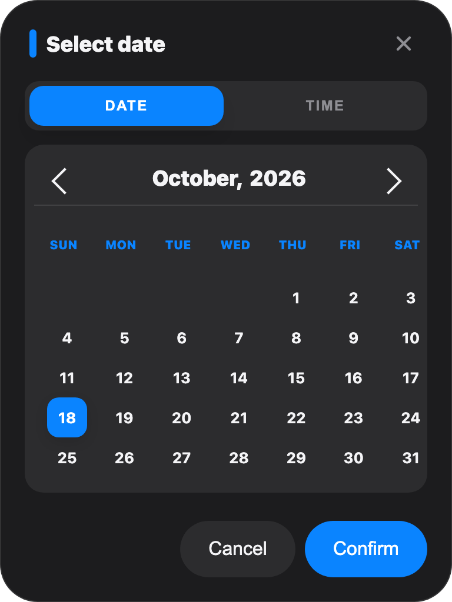
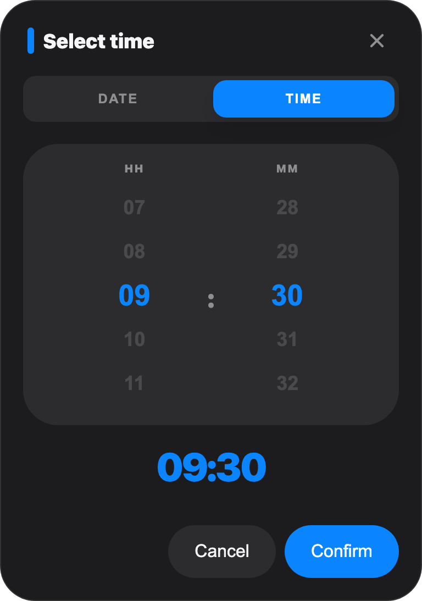

# @salahfarzin/datetimepicker

A React date and time picker for the **Gregorian**, **Jalali** (Solar Hijri) and
**Kurdish** calendars, built on [react-multi-date-picker](https://shahabyazdi.github.io/react-multi-date-picker/).

- Picks in the visitor's calendar but can hand back a Gregorian ISO date, so an API
  always stores `2026-10-18` whatever the visitor sees (`1405/07/26`, `2726/07/26`...).
- Or hands back strings in the shown calendar, when that's what an app stores.
- Kurdish in both variants: Sorani (solar months, year + 1321 from the Solar Hijri
  year, Eastern Arabic digits) and Kurmanji (Gregorian months, year + 700).
- A modal picker, a time picker and a ready-made input field.
- Plain CSS themed with custom properties. Works with or without Tailwind.

## Screenshots

| | Light | Dark |
|---|---|---|
| Date |  |  |
| Time |  |  |
| Jalali, right to left |  |  |

The dark ones use the [dark theme example](#dark-theme) below.

## Install

Installed from a git tag on GitHub (no npm registry):

```sh
npm install github:salahfarzin/datetimepicker#v1.0.0
```

Each tag carries the built `dist/`, so installing needs neither git nor a build step,
which also makes it work in slim CI and Docker images.

Requires React 18 or later. Import the styles once, e.g. in your root layout:

```ts
import "@salahfarzin/datetimepicker/styles.css";
```

## Usage

### A field that opens the picker

```tsx
import { DatePickerInput } from "@salahfarzin/datetimepicker";

<DatePickerInput
  value={birthdate}            // "1990-03-21"
  onChange={setBirthdate}      // gets "YYYY-MM-DD"
  calendar="jalali"            // shows ۱۳۶۹/۰۱/۰۱
  format="YYYY/MM/DD"
  maxDate="2008-10-18"
  labels={{ confirm: "تأیید", cancel: "انصراف" }}
  className="my-field"
/>
```

### The picker on its own

```tsx
import { DatePicker } from "@salahfarzin/datetimepicker";

{open && (
  <DatePicker
    value={value}
    onChange={setValue}
    onClose={() => setOpen(false)}
    calendar="kurdish"
    language="kmr"   // Kurmanji; any other language gets Sorani
    showTime         // value becomes "YYYY-MM-DDTHH:mm"
  />
)}
```

### Values in the shown calendar

With `valueFormat="calendar"`, `value`, `onChange` and string `minDate`/`maxDate` are in
the shown calendar and `format`, in Latin digits:

```tsx
<DatePicker
  value="1405/07/26T10:30"
  onChange={setValue}          // gets "1405/07/20T10:30"
  onClose={close}
  calendar="jalali"
  valueFormat="calendar"
  format="jYYYY/jMM/jDD"       // moment-jalaali's "j" prefixes are fine
  minDate="1405/07/10"
/>
```

An ISO-looking value (`2026-10-18`) is still read as Gregorian when it plainly is one,
so a Gregorian default from an API doesn't break a Jalali form: when `format` uses another
separator, or when its year can't be the calendar's (Jalali years are around 1300–1500,
Kurdish ones around 2700). For the Gregorian calendar both modes are the same.

## Props

`DatePicker`:

| Prop | Type | Default | |
|---|---|---|---|
| `value` | `string` | | `""` for none |
| `onChange` | `(value: string) => void` | | |
| `onClose` | `() => void` | | Cancel, Escape, a click outside, and after a confirmed pick |
| `calendar` | `"gregorian" \| "jalali" \| "kurdish"` | `"gregorian"` | |
| `language` | `string` | | `"kmr"` picks Kurmanji for the Kurdish calendar |
| `format` | `string` | `YYYY-MM-DD` (Gregorian), `YYYY/MM/DD` (others) | For `"calendar"` values and display |
| `valueFormat` | `"iso" \| "calendar"` | `"iso"` | |
| `showTime` | `boolean` | `true` | Adds a time tab and `THH:mm` |
| `minDate`, `maxDate` | `Date \| string` | | A string is read like `value` |
| `labels` | `Partial<DatePickerLabels>` | English | `selectDate`, `selectTime`, `date`, `time`, `hours`, `minutes`, `cancel`, `confirm`, `close`, `open` |
| `portal` | `boolean \| HTMLElement` | `true` | Mounts in `document.body`; `false` renders in place |
| `className` | `string` | | On the dialog |

`DatePickerInput` takes the same props except `onClose`, plus `id`, `className` (the field),
`dialogClassName`, `placeholder` (defaults to the format) and `disabled`. `showTime`
defaults to `false` there.

`TimePicker` (`hour`, `minute`, `onChange(hour, minute)`) and the calendar helpers are
exported too: `parseValue`, `formatValue`, `displayValue`, `toBound`,
`formatCalendarDate`, `pickerCalendar`, `toLatinDigits`, `toIsoString`, and the Kurdish
calendars and locales (`kurdish`, `kurdishGregorian`, `kurdish_ckb`, `kurdish_kmr`).

The main entry is marked `"use client"` for Next.js. To format dates in a server
component, import the helpers from the entry without it:

```ts
import { formatCalendarDate } from "@salahfarzin/datetimepicker/calendars";

formatCalendarDate("2026-10-18", "jalali", "YYYY/MM/DD", "fa"); // "۱۴۰۵/۰۷/۲۶"
```

## Theming

Set these custom properties, e.g. from your own theme variables:

```css
:root {
  --dtp-bg: var(--card-bg);
  --dtp-border: var(--card-border);
  --dtp-text: var(--foreground);
  --dtp-text-muted: var(--foreground-secondary);
  --dtp-surface: var(--surface);
  --dtp-surface-hover: var(--surface-hover);
  --dtp-accent: #0066cc;
  --dtp-accent-soft: rgba(0, 102, 204, 0.08);
  --dtp-on-accent: #fff;
  --dtp-overlay: rgba(0, 0, 0, 0.4);
  --dtp-z: 10000;
}
```

The styles sit in `@layer components`, so Tailwind utilities and any unlayered CSS of
your own override them. Classes are prefixed `dtp-`. With Tailwind, import the stylesheet
after `@import "tailwindcss"`, so Tailwind's layer order (`base` before `components`) is set
first and its preflight doesn't override the picker.

### Dark theme

The defaults are light. A dark theme, as in the screenshots, under whatever selector your
app switches themes with:

```css
[data-theme="dark"] {
  --dtp-bg: #1c1c1e;
  --dtp-border: rgba(255, 255, 255, 0.1);
  --dtp-text: #f5f5f7;
  --dtp-text-muted: #8e8e93;
  --dtp-surface: #2c2c2e;
  --dtp-surface-hover: #3a3a3c;
  --dtp-accent: #0a84ff;
  --dtp-accent-soft: rgba(10, 132, 255, 0.15);
}
```

## Development

```sh
npm install
npm run check   # type check, tests, build
```

### Releasing

`dist/` is committed, because apps install from tags. For a release:

1. Note the changes in [CHANGELOG.md](CHANGELOG.md) and bump `version` in `package.json`.
2. `npm run check`, then commit, including `dist/`.
3. `git tag vX.Y.Z && git push origin main vX.Y.Z`.
4. In the apps: `npm install github:salahfarzin/datetimepicker#vX.Y.Z`.
